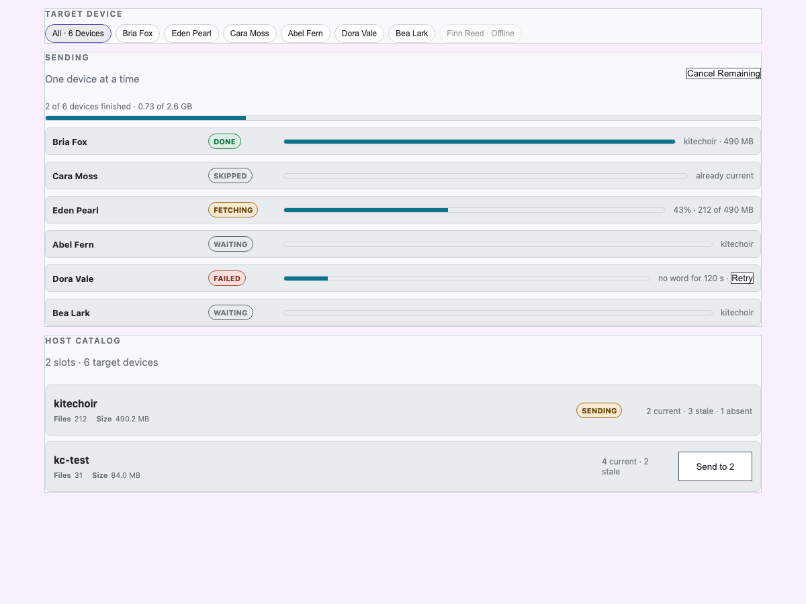

# Fleet asset sends: proposal

Written 2026-10-27 for Bob to ratify. It rests on his rulings from the same
day: one-off operations, one device at a time, All or one device, and a
progress bar. The code facts below come from reading `main` at `529decf`.

## 1. Shape: one send queue

The dashboard keeps **one queue of jobs**, each job being *(device, slot)*.
It runs one job at a time.

- **Send to one device** adds one job; **Send to All** adds one job per
  eligible device.
- A second send while the queue runs just adds its jobs to the end; nothing
  is refused. The queue empties as jobs finish, and the dashboard keeps no
  record of what each device should hold. That keeps it one-off.
- Today's single-device Send and Update go through the same queue, so there
  is one code path and one progress display, not two.
- Remove stays single-device and immediate, as it is today. Bob asked only
  about sending.

### Job lifecycle

| state | meaning |
|---|---|
| waiting | in the queue |
| skipped | when its turn came, the device was offline, unassigned or already current (the inventory fingerprint matches the host's) |
| fetching | `/os/fetch` sent; showing the node's reported progress |
| done | `/os/fetched <slot> ok` |
| failed | `/os/fetched <slot> err`, a timeout, or the device went offline mid-transfer; the row offers **Retry**, which adds the job back to the queue |
| cancelled | the operator cancelled before its turn |

Eligibility is checked **when a job's turn comes**, not when it's added. A
device that comes back online while the queue is still running gets its
turn; one that comes back after the queue has finished doesn't. That
matches the one-off ruling.

**Stall rule.** A job fails with "no word from the device" when no
progress or terminal reply arrives for 120 s (today's `FETCH_STALL_SECONDS`).
The queue then moves on. The node may still finish later; when its
`/os/fetched` arrives, the row updates to done, and the inventory re-query
confirms the result.

**Cancel** removes the waiting jobs. The job already fetching runs to the
end because the contract has no way to cancel a transfer on the node. The
button says so: **Cancel remaining**.

A dashboard restart loses the queue. Rows then show the observed inventory
(current/stale/absent), as the Assets tab already does.

## 2. Wire changes

### 2a. Byte progress (contract 1.23)

Add two optional integer arguments to the existing reply:

```
/os/fetch-progress <slot|patch:name> fetching <done_kib:int> <total_kib:int>
```

- The node first compares files to decide what to download (`plan_file`
  hashes each existing file; a 1.15 GB pack takes about 20–25 s on a Zero 2
  W, per the 2026-07-15 scale reference). While it does that, it keeps
  sending plain `fetching` with no numbers, and the UI shows "checking
  files…".
- `total_kib` counts only the files that need downloading. `done_kib`
  includes bytes resumed from a `.part` file.
- Units are KiB, so a 5 GB pack still fits OSC int32 (bytes would overflow
  at 2 GiB).
- The node sends one reply every second at most, plus one when the last file
  lands, unicast to each requester (as replies already are).
- **Older nodes** send phase only. The UI shows an indeterminate bar and the
  phase, with no percentage. The contract's rule against invented
  percentages still holds.

Pi changes: `fetcher._http_fetch` plans everything first (the list of files
to download and their total size), then downloads with a progress callback.
`bopos._fetch_worker_loop` passes in a callback that throttles the replies.
The `file:` scheme reports the same way.

### 2b. Unicast fetch commands

`_send_fetch_generation` today sends `/<id>/os/fetch` to the physical
broadcast address (`send_physical`). On 2026-10-27, Eden Pearl missed two
broadcast patch fetches, and the same message sent straight to
192.168.0.102:6660 worked at once. The proposal: send to the device's last
heartbeat IP when it's known and the device is physical, and fall back to
broadcast otherwise.

This changes **patch pushes** too, because they share the function. That's
intended: the fix applies to both. Nothing else about patch pushes changes:
`converge_fleet_patch` still fans out to every device at once. Moving patch
pushes onto this queue can come later if Bob wants; patches are small, so
the fan-out costs little airtime.

## 3. UI (Assets tab)



- **Target:** the device picker gains an **All** chip (all online, assigned
  physical devices). Ineligible devices stay listed but disabled, with
  their reason, as today. Single select: All, or one device.
- **Catalog rows with All selected:** the state column summarises the fleet
  ("3 current · 2 stale · 1 absent"). The action reads **Send to 3**,
  counting only devices that aren't current. With nothing to send, it
  reads "No action needed". Remove isn't offered for All.
- **Catalog rows with one device:** as today (Send / Update / Remove).
- **Send panel**, which appears above the catalog while the queue has jobs
  (and stays after it finishes until dismissed):
  - one overall bar showing devices finished out of the total, plus KiB
    across the jobs that reported numbers;
  - one row per job: device name, slot, state, and its own bar
    ("checking files…" / 43% · 212 MB of 490 MB / done / failed + Retry);
  - **Cancel remaining**, and **Dismiss** once the queue is empty.
- **Active-slot warning** asks once per send. With All, it lists the
  devices whose running patch declares the slot.

At 390 px, the panel rows stack (name and state on one line, bar below).

## 4. Server

- `dashboard/asset_queue.py`: the queue and its runner (an asyncio task).
  It uses `osc.fetch` and watches the device's `fetch[slot]` phase.
- The state snapshot gains `asset_queue: {jobs:[…], started_at, finished}`
  through a new `asset_queue` websocket snapshot type, listed in `ws.js`
  `SNAPSHOT_TYPES` (glean `ws-snapshot-handlers`).
- `osc_bridge._handle_fetch_progress` keeps the optional KiB numbers on the
  device as `fetch_progress[slot] = {done_kib, total_kib, at}`.
- `send_distribution` with `kind: "asset"` accepts `uid: "all"` and adds the
  jobs. The `single_asset_target` guard is relaxed to "each job's device
  must be eligible when its turn comes".
- Websocket messages: `cancel_asset_queue`, `retry_asset_job`,
  `dismiss_asset_queue`.

## 5. Build split (after ratification)

1. **fleet-2-fetch-progress-bytes**: contract 1.23 text, node fetcher
   progress, and bridge parsing. Unit tests, plus `tools/simfleet.py`
   reporting the numbers.
2. **fleet-3-unicast-fetch**: unicast `/os/fetch` with broadcast fallback,
   plus a test showing the datagram goes to the device IP.
3. **fleet-4-asset-send-queue**: the server queue, the websocket messages
   and the snapshot type.
4. **fleet-5-assets-all-ui**: the All chip, the fleet summary rows and the
   send panel. A Playwright journey runs against simfleet peers on private
   ports and checks the queue goes one at a time, a skipped current device,
   a failed device with Retry, Cancel remaining, and the 390 px layout.

Steps 2 and 1 don't depend on each other; 3 needs 2; 4 needs 3. Hardware
proof (a real pack to the KC Pis) goes in `fleet-testing` once it's built.

## Open for Bob

- Is **Cancel remaining** (no stopping a transfer already running) enough
  for now?
- Should Remove for All wait for a later request?
